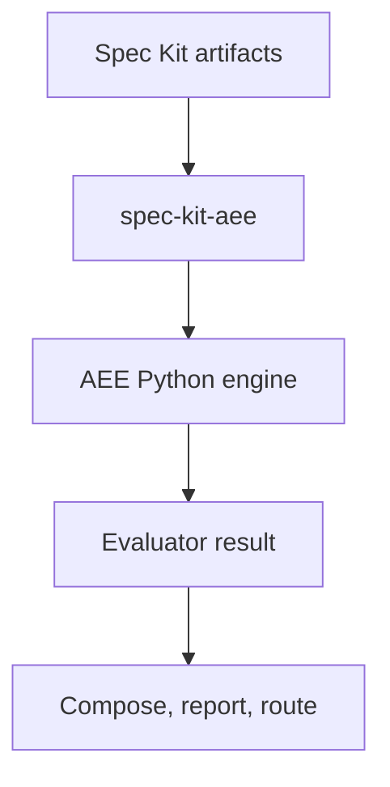

# Spec Kit integration

End users can ask the project's agent to assess a spec or explain missing
evidence; they do not need to learn these installation/runner commands. Spec Kit
renders operation `SKILL.md` files for the selected agent integration. See
[agent workflows and discovery](agent.md#use-through-spec-kit).

The PyPI distribution `applied-epistemic-engineering` (Python import and CLI
`aee`) owns epistemic analysis. The
[`spec-kit-aee`](https://github.com/electrohire/spec-kit-aee) extension owns Spec Kit artifact
discovery, lifecycle hooks, and command UX. The
[`spec-kit-evaluator`](https://github.com/electrohire/spec-kit-evaluator) extension owns the shared
result envelope, composition, reports, and routing.



An AEE assessment is converted with `EvaluatorAdapter`. Rich claim and score data are preserved
inside the evaluator contract's opaque `state.aee` field, while actionable failures become normal
Evaluator Contract findings.

This keeps AEE opinionated and independently versioned without forking or weakening the neutral
Evaluator Contract. The extension IDs are `aee` and `evaluator`, respectively;
neither is a pip install name. A composed `pass` remains a policy outcome, not a
truth or correctness certificate; see [assurance boundaries](names-and-assurance.md).

## Install in a Spec Kit project

First register the [ElectroHire publisher catalog](https://github.com/electrohire/spec-kit-aee#installation)
once per project (or use an organization catalog containing AEE). The default
community catalog is discovery-only, including in Specify 1.2.2. Then install by name:

```bash
specify extension add aee
```

Spec Kit's `requires.tools` metadata is informational, so the extension's runner installs its own
dependencies on first use:

- **This engine:** when the Python running the extension lacks an in-range engine, the runner
  creates a private environment at `.specify/extensions/aee/.runtime/venv` and installs the
  latest `applied-epistemic-engineering>=1.5.0,<2` from PyPI, plus `jsonschema>=4.0` for
  evaluator composition. An engine already installed in that Python takes precedence.
- **The Evaluator extension:** `assess` installs the pinned `spec-kit-evaluator` release
  (currently v1.1.2, SHA-256 verified) through `specify extension add evaluator`.

Set `SPECKIT_AEE_AUTO_INSTALL=0` to disable these installs. The extension and the evaluator are
Spec Kit extensions published as GitHub release archives, not PyPI packages, and are versioned
independently of this engine. The install path is tested on Linux, macOS, and Windows with
Python 3.11, 3.12, and 3.13.
